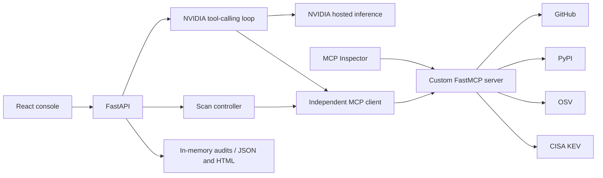

# Gitpilot — RepoGuard MCP 2.0

A read-only audit workspace for public Python repositories. A React console runs real GitHub, PyPI, OSV, and CISA checks through a custom MCP server and an independent MCP client. The NVIDIA assistant can discover and call the same tools. There is no login or database; local audit history and provider caches live in process memory. On Vercel, completed reports stay in the browser tab and carry a server-signed copy for downloads and AI context.

## Run locally

Requires Python 3.12+ and Node.js 20+. From this directory:

```bash
python3 -m venv .venv
source .venv/bin/activate
python -m pip install -r requirements.lock.txt
cp .env.example .env
# Edit .env privately; supply NVIDIA_API_KEY for chat.
# Optional: GITHUB_TOKEN increases GitHub API capacity.
npm --prefix frontend ci
npm --prefix frontend run build
python -m uvicorn backend.main:app --host 127.0.0.1 --port 8000
```

If `.env` already exists, preserve it instead of copying over it. Open [RepoGuard](http://127.0.0.1:8000). The backend serves the built frontend, REST API, and Streamable HTTP MCP endpoint in one process. A convenience script, `bash scripts/run.sh`, installs dependencies, builds the frontend, and starts the local server.

For frontend development, run the backend command above in one terminal and `npm --prefix frontend run dev` in another, then open [the Vite frontend](http://127.0.0.1:5173). Vite proxies `/api` and `/mcp` to port 8000.

Configuration stays on the backend:

| Variable | Purpose |
| --- | --- |
| `NVIDIA_API_KEY` | NVIDIA-hosted inference; needed only for the assistant |
| `NVIDIA_MODEL` | Tool-capable NVIDIA catalog model; default `nvidia/nemotron-3.5-lightning-30b-a3b` |
| `GITHUB_TOKEN` | Optional GitHub API token for higher upstream request limits |

The `.env` file is ignored by Git and excluded from Docker images. The frontend receives configuration status and model name, never credentials. No OpenAI key is required.

## Use the workspace

1. Enter `https://github.com/pallets/flask` or an `owner/repo` identifier in Scan repository, and press Scan repository. All checks are enabled by default; Scan options lets you customize them.
2. Follow the actual MCP executions and open Security findings to inspect dependencies, advisory IDs, remediation evidence, and known exploitation matches.
3. Ask the AI Assistant about the selected repository or audit. Its responses include tool executions and evidence references. Missing provider access is displayed as an error.
4. Use MCP Explorer to discover input schemas, call an approved tool, read a resource, or retrieve a prompt.
5. Open Saved reports to review deterministic readiness, incomplete evidence, execution history, and JSON/HTML exports.

Results start empty. The app never substitutes demonstration findings for unavailable provider responses.

## Protocol surface

The server exposes these thirteen tools:

- `get_repository_info`
- `get_repository_overview`
- `get_repository_structure`
- `get_recent_commits`
- `get_open_issues`
- `get_pull_requests`
- `inspect_ci_status`
- `find_dependency_manifests`
- `parse_python_dependencies`
- `get_package_release_info`
- `scan_known_vulnerabilities`
- `check_known_exploitation`
- `evaluate_release_readiness`

Resources are `repoguard://about`, `repoguard://audit-policy`, and three templates:

```text
repoguard://repository/{owner}/{repo}/overview
repoguard://repository/{owner}/{repo}/dependencies
repoguard://repository/{owner}/{repo}/report
```

The latest-report resource is unavailable until that repository has a completed audit in the current process. Prompts are `analyze_repository`, `explain_security_finding`, and `prepare_release_checklist`.

The implementation uses the maintained FastMCP 2.x package, which provides `FastMCP` and `Client`; it does not depend on the proposed official SDK v2 API named in the source plan. Internal clients use MCP's in-process transport, while external clients can use the mounted Streamable HTTP endpoint or stdio.

```bash
# Discover tools/resources/prompts with the independent client.
.venv/bin/python -m backend.mcp_client

# Invoke a real provider-backed tool through MCP.
.venv/bin/python -m backend.mcp_client get_repository_info \
  --arguments '{"repository":"pallets/flask"}'

# Independent stdio server for compatible MCP clients.
.venv/bin/python -m backend.mcp_server.server

# Start Inspector with a compatible Node 22 runtime, then select Streamable HTTP.
npx --yes --package=node@22 --package=@modelcontextprotocol/inspector mcp-inspector
```

Use `http://127.0.0.1:8000/mcp/` as the Inspector server URL while the backend is running. Inspector is an optional manual verification tool; automated protocol tests do not require it.

## Verification

The automated suite includes 96 backend tests and 3 frontend regression tests covering protocol discovery, input restrictions, parser coverage, readiness, advisory aliases, and readable reports. Live verification exercised all 12 tools, five resources and templates, three prompts, both report exports, the official MCP Inspector, and a NVIDIA-triggered MCP call against a public repository. Advisory data and counts change with upstream updates; skipped dependencies are reported as incomplete coverage.

```bash
.venv/bin/python -m pytest -q
npm --prefix frontend run build

# Backend must be running. Uses live third-party services.
.venv/bin/python scripts/smoke.py

# Also spends NVIDIA inference credits and requires a real MCP call.
.venv/bin/python scripts/smoke.py --ai
```

Unit/API tests use isolated provider mocks and validate protocol discovery, input restrictions, parsing, readiness, report escaping, and API contracts. The live smoke test verifies metadata, the scan flow, exports, resources, and prompts. It reports provider failures explicitly and exits unsuccessfully for incomplete upstream evidence. A successful build alone does not verify live provider access or visual layout.

## Scope and limits

Only public GitHub repository identifiers are accepted. Provider adapters construct requests against trusted HTTPS hosts; repository code is never cloned, installed, or executed. Python support covers requirements text files and basic PEP 621 `pyproject.toml` declarations. OSV queries use exact pinned versions only. Ranges, unresolved directives, unsupported formats, missing manifests, and truncated discovery reduce evidence coverage. Environment markers are included conservatively, and transitive dependencies are not resolved. This is an MVP audit assistant, not a complete vulnerability scanner.

Readiness uses deterministic rules for repository activity, default-branch CI, dependency coverage, known vulnerabilities, and CISA exploitation evidence. High/critical advisories or KEV matches block readiness. Missing evidence yields an incomplete result. The numeric score is evidence coverage under these rules, not a probability that a repository is secure.

The NVIDIA orchestrator allows at most five tool-calling rounds and twelve total tool calls per request. Backend budgets, timeouts, bounded queues, provider response limits, and in-memory caching constrain external calls. Unauthenticated GitHub access is commonly limited to 60 requests per hour per originating IP; an optional token helps when running several audits. A provider's rate limits, unavailable CI, or inference authorization failures remain visible rather than becoming passing checks.

Keep this no-auth application on loopback or a restricted network. The local host/origin policy and rate limits are intended for a reproducible local demonstration, not unrestricted internet hosting. State disappears when the process restarts; no accounts or persistent database are created.

## Container

```bash
docker build -t repoguard .
docker run --rm --env-file .env -p 127.0.0.1:8000:8000 repoguard
```

The container listens internally on all interfaces so Docker port forwarding works; the example publishes only to the host's loopback interface. Keep `.env` outside the image.

## Architecture



`backend/integrations/` contains trusted-provider access and dependency parsing; `backend/mcp_server/` registers protocol capabilities; `backend/mcp_client.py` is the independent client; `backend/services/` implements audits, readiness, and reports; `backend/agent.py` runs the NVIDIA loop; and `frontend/` contains the five-page console.

Primary references: [FastMCP client](https://gofastmcp.com/clients/client), [FastMCP HTTP deployment](https://gofastmcp.com/deployment/http), [NVIDIA inference APIs](https://docs.api.nvidia.com/nim/reference/llm-apis), [GitHub REST rate limits](https://docs.github.com/en/rest/using-the-rest-api/rate-limits-for-the-rest-api), [OSV API](https://google.github.io/osv.dev/api/), and [CISA KEV catalog](https://www.cisa.gov/known-exploited-vulnerabilities-catalog).

### Usability and URL verification — October 31, 2026

The main screen now has one scan form, optional settings, and a short plain-language summary. Details and protocol evidence expand on demand. A layered CSS 3D shield, orbital animation, scan pulses, and page transitions run without a WebGL dependency. Pause visuals is remembered for the browser session; operating-system reduced-motion preferences are respected.

Accepted inputs include owner/repository, HTTPS or HTTP GitHub links, github.com links without a scheme, .git clone URLs, SSH clone identifiers, and repository file/branch/issue/PR links. URL query strings and fragments are ignored. All scans target the default branch, even when the pasted URL names another branch. GitHub Enterprise, profiles, settings pages, private repositories, and non-GitHub hosts are outside this public-repository MVP.

Live verification exercised pallets/flask, psf/requests, expressjs/express, kennethreitz/requests, and a deliberately nonexistent repository. Both HTML and JSON exports returned successfully for each completed/partial/failed report. Flask returned 35 declarations and 14 distinct advisories at verification time; Express returned repository/build evidence with explicitly incomplete Python security coverage. A nonexistent repository produced a clear public-access/spelling error. NVIDIA returned the requested three-sentence explanation of a real finding. These are live observations, not permanent fixture counts or claims that every repository is covered.

Browser verification covered scan submission with a branch link, readable summaries, finding details, assistant response, navigation, and a 390px mobile viewport without horizontal overflow. Automated regression tests cover URL normalization, safe redirects, private/missing/empty repository errors, successful CI reruns superseding stale failures, and timeouts. External provider limits still apply.

To repeat the multi-repository verification while the local server is running:

```bash
.venv/bin/python scripts/verify_live.py
```

This uses live provider quota and writes results to `/tmp/repoguard-live-verification.json`. Unit tests use isolated mocks; the app never displays those fixtures as scan results.

### Expanded public repository overview — November 4, 2026

The Repository overview scan option now calls `get_repository_overview` through the independent MCP client. The tool retrieves seven sections: README preview, source-language breakdown, recent releases, branches, contributors, community files, and a file tree. The repository overview resource returns the same richer profile. Existing metadata now includes owner, creation date, homepage, visibility, fork status, and available repository features.

The analyzer presents profile facts, topics, languages, and expandable sections for README, searchable file paths, recent commits, issues, pull requests, releases, branches, contributors, and community documentation. Source links let users continue on GitHub. The HTML and JSON reports retain this information; large HTML lists show the first 100 entries and point to JSON for the remaining retrieved evidence. The AI receives overview context alongside the security evidence.

This is a bounded public snapshot: up to 10 releases, 30 branches, 20 contributors, 5,000 file paths, 16,000 README characters, and 2,000 characters per release note. Existing activity limits remain 10 commits, 30 issue-endpoint entries (PRs excluded from the displayed list), and 20 pull requests. The scan uses the default branch and a five-minute provider cache. Per-section errors are explicit and do not erase successful sections. GitHub does not expose private information or unlimited history through this unauthenticated public-repository workflow.

RepoGuard combines discoverable MCP tools with OSV package advisories, CISA known-exploitation matching, deterministic release checks, traceable NVIDIA tool use, and readable evidence reports. This describes the project's distinguishing feature combination; it is not a claim that these individual capabilities are exclusive to RepoGuard.

Verification of the expanded overview: 85 automated tests passed and the production frontend built successfully. A live scan of psf/requests retrieved all seven overview sections (2 languages, 2,894 README characters, 10 releases, 8 branches, 20 contributors, 7 community-file entries and 153 file paths). The overview resource and HTML/JSON reports passed live checks. The complete scan remained partial because Python dependency security coverage was incomplete. Browser checks confirmed README presentation and file search for pyproject.toml.

## Deploy Gitpilot to Vercel

The repository is published at https://github.com/ahmedA-gif/Gitpilot. The root `app.py` exposes the FastAPI app; `vercel.json` builds the React frontend and promotes its files to `public/` for CDN delivery. Python 3.12 is selected in `.python-version`.

```bash
vercel link --project gitpilot --scope ahmedg12104-gmailcoms-projects --yes
vercel project inspect --non-interactive --yes
vercel deploy --prod --yes
```

Set `NVIDIA_API_KEY` and `REPORT_SIGNING_SECRET` as sensitive server environment variables in Production and Preview. Set `NVIDIA_MODEL` if overriding the default model; `GITHUB_TOKEN` is optional. None of these private variables belong in a `VITE_` variable or source control. Use a stable, randomly generated signing secret to keep saved reports valid across deployments. The included `scripts/configure_vercel_env.py` configures the known Gitpilot target from the ignored local `.env`, passing values via stdin without printing them.

Hosted scans complete within a single request (up to 230 seconds) rather than depending on a background task surviving between function invocations. Recent reports are kept in browser session storage; downloads, latest-report resource requests, and AI follow-ups use the signed report copy and can run on another function instance. A refresh during an unfinished hosted request requires a new scan. The MCP HTTP transport is stateless. Local development retains background scanning with progress polling. Provider quotas and per-instance request budgets still apply; this no-database deployment is an MVP, not a distributed job system.

## Gitpilot release verification — November 6, 2026

The release review fixed duplicate OSV queries for equivalent package names/versions while retaining all manifest sources, corrected numerical ordering of fixed versions, prevented unrelated affected packages from overriding severity, prioritized root manifests under discovery limits, and made malformed NVIDIA responses return readable errors. Selected signed reports now use request-local context rather than replacing a shared report. Hosted activity retains manual and assistant calls alongside scan calls; corrupt stored report entries are ignored.

Validation: 96 backend tests, 3 frontend tests, production frontend build, dependency compatibility check, and whitespace/diff checks passed. The new frontend tests run on Node.js 20+ using the installed TypeScript compiler. `requirements.txt` lists the exact versions from the tested lockfile directly for compatibility with Vercel’s dependency parser. Existing `repoguard://` resource addresses remain compatible. Gitpilot is the product name.

Configure the intended deployment explicitly:

```bash
.venv/bin/python scripts/configure_vercel_env.py --project gitpilot --scope ahmedg12104-gmailcoms-projects
```

The helper verifies the linked project name before sending any server-only environment values. The GitHub origin is https://github.com/ahmedA-gif/Gitpilot; the prior RepoPilot repository remains available as the `repopilot` remote.
